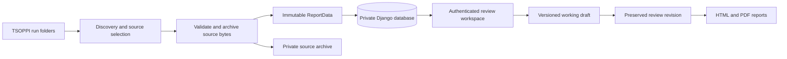

# Prontian

[](https://github.com/Christian-Bjornstad/Prontian/actions/workflows/ci.yml)
[](LICENSE)

**From sequencing output folders to a traceable molecular review and report.**

Prontian imports TSOPPI/TSO500 output, keeps a private copy of the source files,
and presents small variants, CNV, RNA, QC and biomarkers in one review workspace.
Reviewers save working drafts, preserve finalized revisions and export HTML or
PDF reports. A native Python/Qt application manages import, accounts, storage,
backup and the local Django report server.

The name combines **pronto + Christian**. This is an independent repository
derived from InPreD/PRONTO. See [source and acknowledgements](NOTICE.md).

**Deployment scope:** an authenticated local workstation application. The
bundled server binds to `127.0.0.1`. Institution-specific clinical validation,
backup ownership and access approval are prerequisites for operational use.
See [production readiness](docs/production-readiness.md) before deployment.

## Start here

| Your goal | Read |
| --- | --- |
| Install, import and review a report | [Norwegian user guide](docs/desktop-app.md) |
| Add late post-QC fusion/splice files and MOL CNV pages | [Post-QC guide](docs/post-qc-rna.md) |
| Understand the whole system | [Architecture and diagrams](docs/architecture.md) |
| Understand exactly which input files are used | [Input contract and import pipeline](docs/data-flow.md) |
| Understand stored data, permissions and revisions | [Database guide and ER diagrams](docs/database.md) |
| Find the file responsible for a behavior | [Code guide](docs/code-guide.md) → [every source file](docs/code-reference.md) |
| Change code or run quality checks | [Contributing](CONTRIBUTING.md) |
| Upgrade, back up, restore or troubleshoot | [Operations](docs/operations.md) |
| Inspect measurements and validation evidence | [Performance](docs/performance.md), [validation](docs/validation.md) |

## What the application does

- Finds run folders by date or exact run ID, or accepts one to five explicit
  source roots. The preview identifies missing or conflicting sources.
- Separates DNA and RNA using explicit source claims. Identifiers must agree;
  similar names never establish a sample match.
- Archives bounded source files with SHA-256 checksums and imports one validated
  report at a time. Reimporting identical content does not duplicate a report.
- Preserves imported facts separately from human review, including source
  defaults, value corrections, include/exclude decisions and report highlights.
- Supports small variant, CNV and RNA review; QC plots; searchable compact/full
  tables; comments; manual CNV rows; and presentation figures.
- Accepts late post-QC RNA workbooks through an exact-sample preview and explicit
  confirmation. Source history stays attached to its review revision; RNA
  Oncogenic/VUS classification is independent of technical QC.
- Uses saved review state for summary HTML and two PDF layouts: ESMO and
  presentation. Exports have attributed audit records.
- Appends standard CNV overview panels A2, then B3/C1, to the landscape MOL PDF.
- Provides IGV region inspection using bundled browser code and local reference
  files. Persistent alignment storage is optional and disabled without policy
  and quota configuration on a supported Linux host. Windows supports local viewing.

Prontian consumes pipeline results. It does not run sequencing analysis or make
live annotation queries against ClinVar, COSMIC, gnomAD or OncoKB. Annotation
values come from supplied tables. Interpretation remains a reviewer action.

## Quick start on Windows

Use **64-bit Python 3.14**. Run PowerShell in the checkout. PDF plots are read
by bundled PDFium; Poppler is an optional fallback.

```powershell
git clone https://github.com/Christian-Bjornstad/Prontian.git
cd Prontian
py -3.14 -m venv .venv
.\.venv\Scripts\python.exe -m pip install -r requirements-lock.txt
.\.venv\Scripts\python.exe -m pronto_desktop
```

The first start creates an empty installation when no existing location is
configured. Create an administrator in the first-account dialog, then create
personal reviewer accounts. Open **Importer**, find a run or select its folders,
inspect the preview, resolve source conflicts, select samples and import.
**Åpne rapporter** opens the authenticated browser workspace.

Windows installations using Python FELLES/Ivanti can use
`PRONTIAN_INSTALL.cmd`, then `PRONTIAN_START.cmd`. The
[desktop guide](docs/desktop-app.md) explains the launchers and existing databases.

To try import without patient data:

```powershell
.\.venv\Scripts\python.exe scripts\create_desktop_example.py --output examples\generated\run
```

Select the generated run's folders in the importer. The example deliberately
uses `Create_report=-`; explicitly select its DNA sample in the preview.
The output path must be new. [Input examples](docs/data-flow.md) explain the files.

For a browser-only local session, use `scripts/start_web.py` as described in
the [startup guide](docs/oppstart-nb.md). Linux commands use `.venv/bin/python`
in place of the Windows executable.

## How the pieces fit together



Source files define **ReportData**. Human decisions define **ReviewState**.
The database stores both, together with grants, assets and audit events.
HTML and PDF renderers project those contracts into views; they do not rewrite
source data. See the [detailed flow](docs/data-flow.md) and
[revision lifecycle](docs/database.md#review-lifecycle).

```text
Prontian/
├── pronto_desktop/       Native app, configuration, accounts and local server
├── pronto_ingest/        Run lookup, discovery, validation and import
├── pronto_report/        Contracts, schemas, adapters, review rules and rendering
│   ├── adapters/         TSV/CSV/XLSX and Cancan readers
│   ├── review/           Commands, source defaults and gene lists
│   ├── renderers/        HTML, PDF, plots and display projections
│   ├── schemas/          Versioned ReportData and ReviewState JSON Schema
│   ├── static/           Owned JS/CSS, artwork and licensed IGV distribution
│   └── templates/        HTML panels and report shell
├── pronto_web/           Django settings, routes, models and HTTP handlers
│   └── reports/          Persistence, grants, exports, drafts and alignment APIs
├── pronto/tests/         Import, report, native GUI and browser tests
├── test_data/            Approved public integration fixture
├── scripts/              Setup helpers, synthetic examples and quality tools
└── docs/                 User, developer and operations guides
```

The `pronto_*` package names and database identifiers are compatibility names.
Renaming a repository does not require migrating patient records or replacing
an installation key. All database migrations remain versioned. The retired
PPTX command, Office templates, transit forms and upstream Docker publishing
configuration are excluded from this application.

## Data lives outside the repository

The desktop defaults to `.local-web/` unless a saved or explicit location is
selected. A custom data root normally uses this layout:

```text
private-data/
├── database/pronto.sqlite3    Reports, users, reviews, grants, assets and audits
├── secret.key                Persistent installation key
├── raw_imports/              Hash-verified source snapshots
└── backups/                  SQLite backups before migrations and on request
```

Legacy installations can use `pronto.sqlite3` directly in the data root.
Alignment storage and references have separate locations. Per-user desktop
preferences remain in `%LOCALAPPDATA%\PRONTO\desktop.json` for compatibility.
Private state and production exports are excluded from Git.
[Operations](docs/operations.md) describes complete backups.

## Quality and reproducibility

CI checks Python lint/format, browser JavaScript lint/format, documentation links
and source coverage, Mermaid parsing, dependencies, database migrations,
Windows/Linux tests and Chromium report workflows.

```powershell
.\.venv\Scripts\python.exe -m pip install -r requirements-dev.txt
npm ci --ignore-scripts
.\.venv\Scripts\python.exe scripts\check_quality.py
.\.venv\Scripts\python.exe -m pytest -q
.\.venv\Scripts\python.exe manage.py test pronto_web.reports --settings=pronto_web.test_settings
```

Browser tests require `python -m playwright install chromium` first. Linux IGV
tests use `pysam`; those platform-specific tests are unavailable on Windows.
See [CONSTRAINTS.md](CONSTRAINTS.md) for the maintained quality baseline.

Folder discovery uses per-scan caches and exact source indexes. In the recorded
synthetic 100-sample benchmark, median local discovery fell from **2.99 s to
0.55 s**, with **89% fewer `Path.lstat` calls**. This measures discovery only;
network-disk, import and PDF timings must be measured separately.
[Method and results](docs/performance.md).

## Contributing and license

Read [CONTRIBUTING.md](CONTRIBUTING.md) before changing source or fixtures.
Use [SECURITY.md](SECURITY.md) for private security reports. Keep real clinical
records and access information out of public issues and test artifacts.

GNU GPL version 3; see [LICENSE](LICENSE), [NOTICE.md](NOTICE.md) and the bundled
IGV license. Prontian is not represented as an official hospital product or a
certified diagnostic device.
