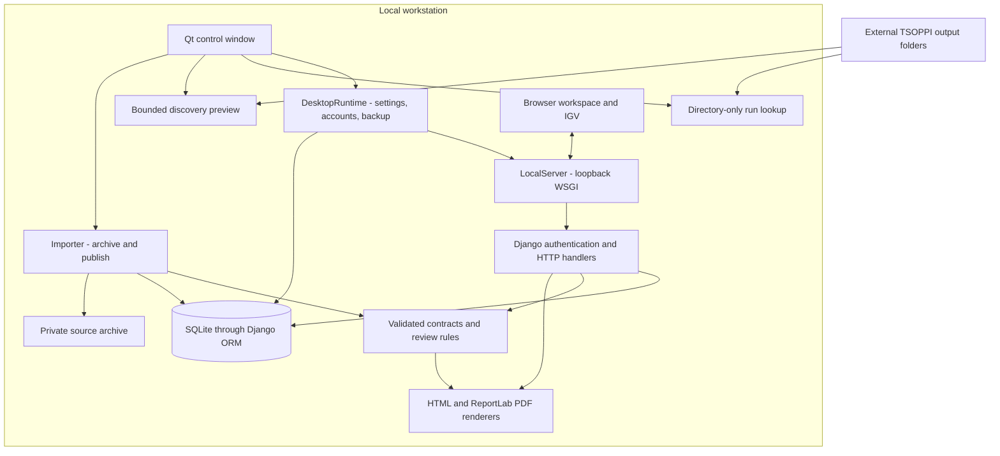
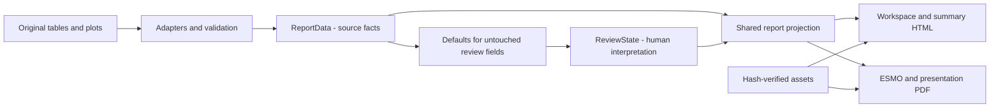
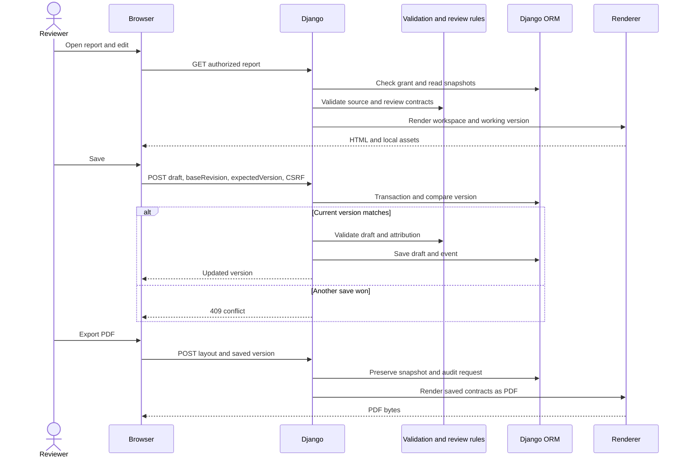

# Architecture

Read this with [the code guide](code-guide.md), [data flow](data-flow.md) and
[database](database.md). Diagrams describe the current implementation.

## Components and boundaries

The Qt window orchestrates background jobs. Filesystem traversal, database
queries and import run outside its GUI thread. `DesktopRuntime` owns settings,
safe database initialization and server lifecycle. `LocalServer` is a bounded
threaded WSGI host; it proves an installation-key/database identity before
reusing an existing server.

`pronto_ingest` converts directory selections into immutable `DiscoveryPlan`
and `ReportPlan` objects. Run lookup only lists directories; discovery examines
headers and bounded table content. Import independently revalidates paths,
identity and freshness, then archives and publishes one sample at a time.

`pronto_report` owns JSON contracts, immutable snapshots, stable identity rules,
review commands, adapters and renderers. Django implements the review repository
and authorizer interfaces. HTTP handlers authorize access before fetching
private assets or running review/export commands.

## Source, interpretation and presentation

A correction records an effective value and reason in review state; it does not
overwrite the imported source. Import fingerprints and asset hashes preserve
provenance. Duplicate variant occurrences receive separate occurrence IDs even
when their biological variant ID is equal.

ReportData schemas 1.0 and 2.0 remain readable; current adapters produce 2.0 with
complete source tables. Review schemas 1.0–4.0 remain readable through explicit
migrations and source-default upgrades. Version 4 supports unified finding
review, section QC and manual CNV rows. JSON contract migration and Django
table migration are separate processes.

## Request and export path

An export audit records a request, not proof that a browser saved or printed the
file. Working draft export can freeze a snapshot and advance the active draft
revision. Finalized records remain available in history.

## Storage and trust boundaries

SQLite stores JSON contracts, grants, binary report assets, presentation figures
and audit metadata. `raw_imports` stores immutable source copies. Large saved
alignment bytes use opaque keys in private filesystem storage; their metadata
lives in SQL. Local references are served through authenticated routes.

Browser-selected BAM/CRAM viewing is separate from server upload. Persistent
alignment saving requires its own permission, policy switch, quotas and staging
lifecycle. IGV JavaScript is bundled; local review needs no CDN when references
are configured locally.

The workstation server binds only to loopback. SQLite over SMB is not a validated
multiwriter deployment. Network exposure requires a separate application server,
HTTPS, database strategy and operational testing; see [readiness](production-readiness.md).

## Maintained decisions

- [ADR 0001: independent repository](decisions/0001-independent-repository.md)
- [ADR 0002: stable contracts and storage](decisions/0002-preserve-contracts-and-storage.md)
- [ADR 0003: discovery cache lifetime](decisions/0003-discovery-caches.md)
