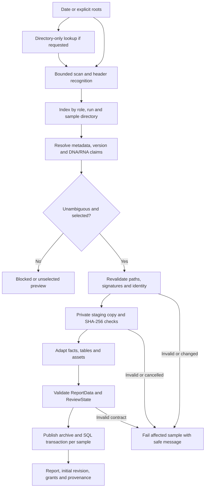

# Input contract and import pipeline

Prontian reads analysis outputs without modifying selected source folders.
Review starts after a validated source snapshot has been stored. Generate an
executable synthetic example with:

```powershell
.\.venv\Scripts\python.exe scripts\create_desktop_example.py --output examples\generated\run
```

## Directory families

For an exact run ID `YYMMDD_INSTRUMENT_0001_FLOWCELL`, discovery recognizes:

| Directory suffix | Internal version | Meaning |
| --- | --- | --- |
| no suffix or `_TSO_500_LocalApp_postprocessing_results` | `raw` | Pipeline output |
| `_CNVs` | `cnv` | Cancan results |
| `_report_preQC` | `legacy` | Earlier pre-QC outputs |
| `_report_preQC_newPRONTO_version` | `new` | Newer pre-QC outputs |
| `_report_withQC` | `qc` | Reviewed variant/RNA outputs |

These PRONTO terms are preserved input format identifiers. Role words tolerate
established case/separator aliases; sample and run identities remain exact.
The nearest declared run directory defines scope.

Automatic selection prefers QC variants for the exact sample, then `new`,
`legacy`, `raw`. Explicit selection does not silently fall back to another
primary variant version. CNV plots may fall back to raw when the selected
report version lacks a plot; source tables follow their own contract.

## Source roles

| Role | Recognition / expected content | Requirement |
| --- | --- | --- |
| `metadata` | `Sample_id`, `Sequencing_run_id`, `Study_id`; optional clinical fields | Required |
| `summary` | One matching `sample_id` row; `TMB`, `MSI` | Required |
| `variants` | `Gene_symbol`, `Genomic_location`, `DNA_change`; raw or `forQC` table | Required |
| `sample_list` | `sample_type`, `sample_ID`; exact DNA and explicit RNA | One linkage method |
| `linkage` | Recognized concordance or raw variant comments | One linkage method |
| `cnv_table` | `Gene_Symbol`; merged FC preferred over fraction | Optional |
| `cancan_table` | `chr`, `gene.name`, `total.cn`; main/alt01/alt02 solution | Required if Cancan selected |
| `rna_table` | `Provisional_Event_Type`; exact linked RNA; reviewed QC preferred | Optional |
| `cnv_plot`, `qc_plot` | Known sample-specific PDF/PNG names | Optional |
| `signature_plot`, `rna_profile_plot` | Known signature or RNA profile names | Optional |
| `supporting` | Recognized tables under selected-version `extra_files` | Optional |

The loose-folder legacy profile requires a sample list plus metadata, summary
and variants. The versioned profile also accepts concordance comments for
linkage. Every available explicit DNA/RNA claim must agree. Conflicting
candidates block the affected sample. Unscoped optional sources need explicit
selection. Unsupported files remain visible in a bounded unassigned preview.

Illustrative metadata, with tab-separated cells:

```text
Sample_id	Sequencing_run_id	Study_id	Create_report
SYN0001-D01-P01-A01	261024_A00000_0001_ASYNTHETIC	SYNTHETIC0001	Y
```

`Y/YES/JA/TRUE/1` selects the sample. Negative flags block selection. Empty or
`-` requires explicit selection; unknown/conflicting values block import.
Missing Study_id stays missing. A manual value becomes an import override;
the original archived metadata bytes are retained.

## From folders to stored report



`discover_folders()` returns immutable plans. Identity comes from metadata,
not guessed patient filenames. A user can map a discovered candidate or select
a permitted sample.

`import_plan()` rechecks signatures, bounds and identity, archives copies,
hashes the bytes and compares the source before/after copying. Adapters build
ReportData and complete source tables; plots are decoded within limits. Each
successful sample is committed with an initial review and grants. A failed
sample leaves no published report; previously completed samples stay committed.
Handled errors clean up the affected archive/staging. SQL and the filesystem
are not a single crash-atomic transaction; back up and restore both.

The fingerprint covers source content and import options. An identical report
returns `already_imported`. Changed content for an existing identity conflicts
instead of overwriting imported facts.

## Contracts and normalization

`adapters/pronto_output.py` produces ReportData 2.0 and retains raw biomarker
values and provenance. `source_tables.py` keeps full CNV/RNA tables and bounds
TSV/CSV/XLSX reading. `cancan.py` projects the selected gene table. `identity.py`
assigns report, biological variant and occurrence IDs. `validation.py` enforces
JSON Schema and semantic references before creating immutable snapshots.

Missing data stays missing. The adapter does not fetch annotations from external
databases. TMB/MSI come from the summary; Prontian does not rerun the retired
analysis filters. Gene-list membership does not automatically include a finding.

## Bounds and safety

Discovery accepts 1–5 nonoverlapping roots, at most 50,000 files and depth 30,
candidate files up to 25 MiB and text tables up to 10,000 rows. It rejects
symlinks and Windows junction/reparse components, including selected ancestors.
Unsupported alignments are not opened as tables.

Ancestor checks, table rows and linkage comments are cached only within one
scan. A fresh scan and import recheck sources independently. Cancellation is
checked while traversing and copying; it does not undo committed samples.

Plots have additional decoder, page/pixel and total-asset bounds. See
`importer.py`, `renderers/assets.py` and `renderers/pdfium.py` for enforced limits.
