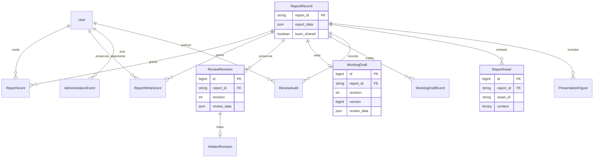
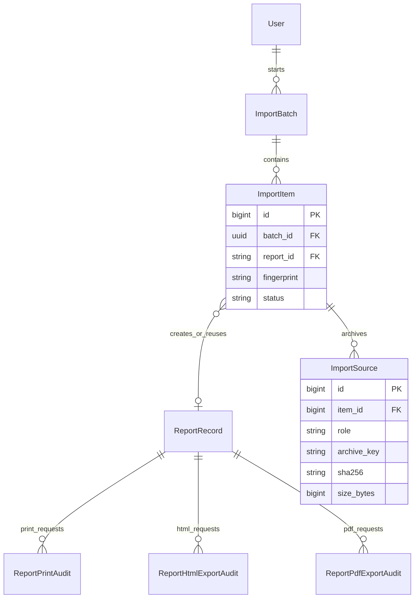
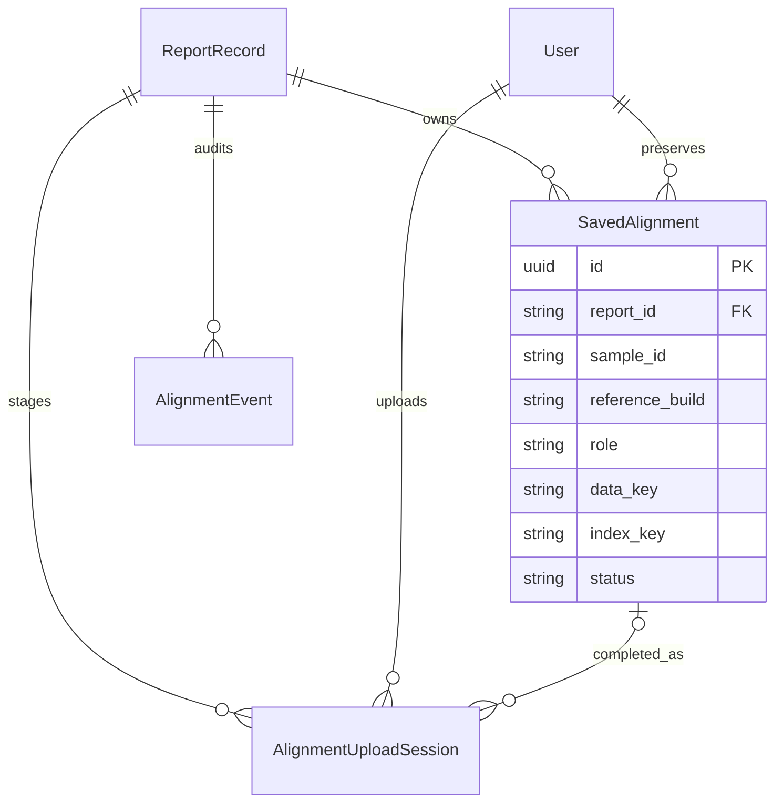
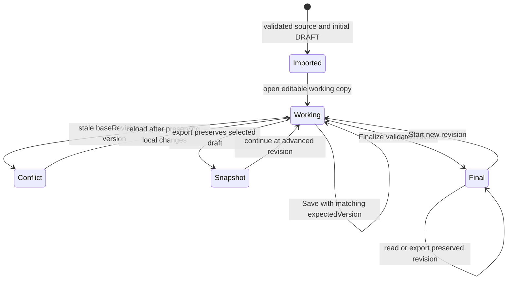

# Database and persisted contracts

The runtime uses Django ORM with SQLite. There is no separate variant knowledge
database: source annotations are embedded in imported ReportData and complete
source tables. SQL owns access, snapshots, assets and audit relationships.
The models are in [models.py](../pronto_web/reports/models.py); all migrations
remain under [migrations](../pronto_web/reports/migrations).

## Core relational model

Names below are Django model names. Physical tables retain the `reports_`
prefix. Fields shown are selected keys, not the complete schema.

`ReportRecord.report_id` is the stable primary key. ReportData contains source
sample/run facts, provenance, variants, biomarkers, source tables and attachment
descriptors. `ReportAsset` holds the private bytes named by those descriptors.
The `(report, asset_id)` pair is unique.

`ReviewRevision` is unique by `(report, revision)`. A report has at most one
`WorkingDraft`; its monotonic `version` enables compare-and-swap saves. A unique
grant per `(report, user)` authorizes reading/review. Alignment write grants
are independent. Team import can grant existing members through `team_access`;
permissions are not inferred from Windows file access alone.

## Import and export provenance

Import batches track an actor, lifecycle and timestamps. An item tracks one
sample/run outcome and fingerprint. ImportSource names a private archived file,
its role, original name, relative storage key, size and SHA-256. Archive keys
are unique. Do not move `raw_imports` independently of the database.

Print, HTML and PDF audits use unique `(report, request_id)` keys for idempotent
requests. They record revision, actor/attribution and request time. PDF audits
also record layout and template version. Their existence is not proof that a
download or physical print completed. `PresentationFigure` stores immutable
private raster content, hash and upload attribution.

## Optional alignment storage

Alignment bytes stay outside SQL. SavedAlignment stores opaque data/index keys,
sizes, hashes and READY/DELETING state. A partial unique constraint permits only
one READY pair for `(report, sample_id, reference_build, role)`. Upload sessions
bound expected/received byte counts and have an explicit state machine.
AlignmentEvent survives pair deletion as minimal audit provenance. Quota,
staging cleanup and reconciliation details are in [IGV operations](igv-alignment-operations.md).

## Review lifecycle

Save updates the current working draft and adds a WorkingDraftEvent. It does
not create a historical revision on each keystroke or save. Finalization and
export preserve snapshots. FINAL records are not edited in place. A new working
revision can derive from a preserved snapshot; replacing an existing draft is
explicit. HiddenRevision hides history from normal presentation without deleting
the preserved review. AdministrationEvent records privileged account/history actions.

## JSON contracts

| Contract | Definition | Responsibility |
| --- | --- | --- |
| ReportData 1.0 | `report-data-v1.schema.json` | Source facts and provenance |
| ReportData 2.0 | `report-data-v2.schema.json` | Current source contract with complete source tables |
| ReviewState 1.0 | `review-state-v1.schema.json` | Original review contract |
| ReviewState 2.0 | `review-state-v2.schema.json` | Structured notes and attribution |
| ReviewState 3.0 | `review-state-v3.schema.json` | Finding/biomarker review and section QC |
| ReviewState 4.0 | `review-state-v4.schema.json` | Current review including manual CNV rows |

Schemas live in [schemas](../pronto_report/schemas). Validation also checks
cross-document identity and occurrence references. Serialization is deterministic;
Python snapshots freeze nested objects. `migration.py` and `review/source_defaults.py`
upgrade old review documents while preserving already reviewed values.

## Migration and recovery

Never delete migration files when creating a fresh repository. Migration 0003
merges the earlier parallel review-audit and alignment branches. Later migrations
add working drafts, import provenance and team visibility. The current schema
must be checked with `makemigrations --check --dry-run`.

Desktop initialization backs up an existing database before pending migrations
using SQLite's backup API, then checks integrity. It requires the original
installation key and refuses to replace a missing database/key with a new one.
For a complete recovery preserve SQL, source archives, references and optional
alignment stores together. See [operations](operations.md).
