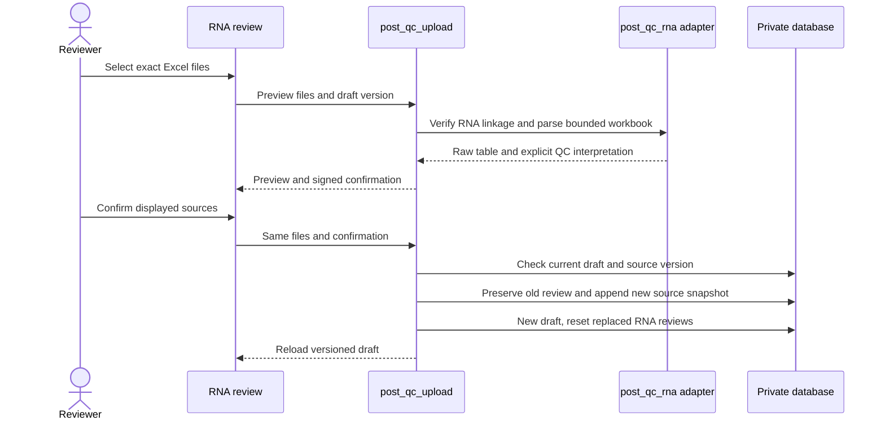

# Post-QC-fusjoner, splice og CNV-vedlegg

## Daglig bruk

1. Importer kjøringen som vanlig. Post-QC-filen trenger ikke finnes ennå.
2. Når bioinformatikernes gjennomgang er klar, åpne pasientens rapport og et
   **utkast**. En ferdigstilt rapport må først få en ny revisjon.
3. Lagre eventuelle endringer. Gå til **RNA review → Load post-QC fusion /
   splice files** og velg én eller flere konkrete `.xlsx`-filer. Du kan hente
   dem direkte fra separate `fusions`- og `splice`-mapper; ingen ny kjøringsskanning
   er nødvendig. Liknende filnavn i de to mappene er tillatt.
4. Trykk **Preview post-QC files**. Kontroller prøve-ID, kategori, gener,
   eksoner, lesestøtte, konsekvens og teknisk QC. Forhåndsvisningen viser hvilke
   kombinasjoner av RNA-prøve og hendelsestype som erstattes.
   Den viser også hvilken DNA-prøve og kjøring filene skal knyttes til. Kontroller
   at filene kommer fra denne kjøringens post-QC-mappe: arbeidsbokformatet har
   ikke en påkrevd kjørings-ID som programmet kan kontrollere automatisk.
5. Trykk **Import confirmed post-QC files**. Originalfilene arkiveres, og et
   nytt utkast med versjonert kildegrunnlag åpnes. Andre funn og notater beholdes.
   Erstatter du fusjoner, krever disse ny vurdering; øvrige splice-funn beholdes.
6. Slå på redigering og angi **Include/Exclude**, **Clinical class** (for
   eksempel Oncogenic eller VUS), kommentar og eventuelt rapporthøydepunkt.
   Lagre før eksport eller ferdigstilling.

Teknisk PASS betyr at hendelsen er klar for faglig vurdering. Det setter ikke
automatisk Oncogenic, VUS eller Include. FAIL, tom og ukjent teknisk QC kan
inspiseres i kildetabellen, men kan ikke inkluderes som post-QC-rapportfunn.

## Kolonner og rapporttekst

Kolonnene identifiseres ved navn, ikke bokstavposisjon. Alle øvrige kolonner og
originale celler bevares og kan leses i **Full table**.

| Kildekolonne | Bruk |
| --- | --- |
| `Gene_A`, `Exon_A` | Første partner og deklarert ekson |
| `Gene_B`, `Exon_B` | Andre partner og deklarert ekson |
| `Event_Support_Dedup_Percentage` | Eksakt kildeverdi; avrundet prosent i rapporttekst |
| `Outcome` | Biologisk konsekvens i standardoppsettet |
| `QC_Verdict` | Teknisk PASS/OK/FAIL i standardoppsettet |
| `Sample_ID`, `Event_ID`, `Provisional_Event_ID` | Eksakt prøve og hendelsesidentitet |
| `Event_Type` / `Event_type`, ellers `Provisional_Event_Type` | Endelig kategori når oppgitt |

Eksempel: **AKT3 (exon 1)::CEP112 (exon 17), 13% read support, out-of-frame**.
12.676 beholdes som kildeverdi. Avrunding er til nærmeste hele prosent, med
halvverdier oppover. Manglende eksoner eller konsekvenser blir ikke utledet.

To oppsett støttes:

- Standard: `Outcome=out-of-frame`, `QC_Verdict=PASS`.
- Gjenkjent ombytting: `Outcome=OK`, `QC_Verdict=out of frame`.
  Forhåndsvisningen merker dette eksplisitt. Råcellene omskrives ikke.

Radfarge brukes ikke til å fastslå teknisk PASS eller klinisk betydning.
Ukjente verdier krever avklaring i kilden; de godkjennes ikke ved gjetning.

## Identitet, samtidighet og historikk

Filnavnet skal være `<eksakt RNA-ID>_fusion_and_splice_variant_candidates.xlsx`,
eventuelt med `_withQC` før filendelsen. Alle rader i filen må ha samme
`Sample_ID`, koblet til rapportens DNA-prøve gjennom importert kildemateriale.
Prefikslikhet eller valg av fil etablerer aldri en pasientkobling.

Nye kjøringsimporter lagrer allerede kontrollert RNA-kobling i databasen.
Eldre importer kan bruke verifiserte RNA-kilder eller sjekksumkontrollert
`sample_list`/koblingskommentar fra det private kildearkivet. Desktop-appen
konfigurerer arkivstien. Ved separat webdrift må `PRONTO_RAW_IMPORT_ROOT` peke
til det opprinnelige arkivet. Manglende eller motstridende kobling stopper importen.

Forhåndsvisning lagrer ingenting. Bekreftelsen er gyldig i 15 minutter og gjelder
samme bruker, rapport, filbytes, kildeversjon og utkastversjon. Endringer i
filene eller samtidige lagringer krever ny forhåndsvisning.

`ReportRecord.report_data` beholdes uendret. En `ReportSourceRevision` lagrer
nytt ReportData, aktør/tid, filnavn/SHA-256/størrelse og en privat ZIP med
originale arbeidsbøker. Før kildebyttet bevares det eksisterende utkastet.
Historiske visninger og gjentatte eksportforespørsler bruker tilhørende kildeversjon.
Gjenåpning av en gammel revisjon gjenoppretter også dens kildegrunnlag.

Originale RNA-domeneplott fra kjøringsimporten beholdes som kildereferanser.
Excel-etterinnlastingen oppdaterer ikke disse figurene og kobler dem ikke
automatisk til nye kandidatfunn. Kontroller plottets filnavn og genetiketter.

## CNV i MOL-PDF

**Presentation PDF** er MOL-rapporten i landskapsformat. Standardvedlegget er:

1. **A2**, side 2 i standardoversikten, på egen side.
2. **B3** fra side 4 øverst og **C1** fra side 5 nederst på neste side.

Figurene skaleres proporsjonalt uten beskjæring. Vedlegget kommer før eventuelle
manuelt valgte presentasjonsfigurer. ESMO-PDF får ikke dette MOL-vedlegget.
Kilden er den importerte, sjekksumkontrollerte `*_CNV_overview_plots.pdf` med
ni sider. Manglende, konkurrerende eller andre sideoppsett gir en tydelig
«CNV appendix unavailable»-side. En erklært kildefil som mangler i databasen
eller har feil sjekksum stopper eksporten.

## Grenser og feilsøking

- Én arbeidsbok per RNA-prøve/hendelsestype i samme bekreftelse. Konkurrerende
  kilder og dupliserte hendelser avvises.
- Maksimalt ti filer og 25 MiB totalt per valg; én arbeidsbok har ett ark,
  maksimalt 10 000 datarader og 500 kolonner. Bruk tallverdier for lesestøtte,
  ikke Excel-formler som må kjøres.
- Tomme arbeidsbøker kan ikke slette gamle funn. Denne flyten gjelder positive
  kandidatfiler. Ekskluder funnet faglig eller gjenåpne ønsket tidligere kildeversjon.
- Hver rapport har grense på 64 MiB rå post-QC-filer og 100 kildeversjoner.
- Det mottatte ønskelisteeksemplet har ulike anonymiserte prøve-ID-er mellom
  radene og filnavnet, og ombyttede QC-/Outcome-verdier. Det er et format-eksempel;
  den blandede prøveidentiteten kan ikke godkjennes som en ekte pasientimport.
  Vedleggene er ikke lagt i det offentlige repoet. Testene lager syntetiske filer.

For utviklere: [spesifikasjon](spec-post-qc-rna.md), [kodeguide](code-guide.md),
[database](database.md) og [operasjonelle rutiner](operations.md).
